# BookLeaf Publishing — Technical Assignment 2 of 2

## Author Royalty Dashboard & Automated Notification System

> **Candidate**: Vaibhav Agarwal  
> **Position**: Full-Stack Developer  
> **Stack**: **Bubble.io** (Application Platform & Database) + **n8n Cloud** (Workflow Automation Engine) + **Google Gemini 2.5 Flash** (AI API)  
> **Repository Deliverables**: Bubble Live App, n8n Workflow Export (`bookleaf_n8n_royalty_workflow.json`), and Technical Architecture Documentation.

---

## 📑 Table of Contents

1. [Executive Summary & Live Access Links](#1-executive-summary--live-access-links)
2. [Test Login Credentials](#2-test-login-credentials)
3. [Database Architecture & Schema Rationale](#3-database-architecture--schema-rationale)
4. [Bubble ↔ n8n Integration Architecture](#4-bubble--n8n-integration-architecture)
5. [n8n Automation Engine Deep Dive](#5-n8n-automation-engine-deep-dive)
6. [AI Prompt Strategy & BookLeaf Policy Grounding](#6-ai-prompt-strategy--bookleaf-policy-grounding)
7. [Error Handling, Webhook Security & Idempotency](#7-error-handling-webhook-security--idempotency)
8. [Reflection on Learning Bubble.io](#8-reflection-on-learning-bubbleio)
9. [3–5 Minute Loom Screen Recording Script](#9-35-minute-loom-screen-recording-script)
10. [Submission Checklist for HR](#10-submission-checklist-for-hr)

---

## 1. Executive Summary & Live Access Links

This system implements an end-to-end **Author Royalty Management and Automated Communication Portal** built to meet BookLeaf Publishing's operational workflows:

- **Author Portal**: Authors securely authenticate to view real-time sales figures, royalty calculations (Earned, Paid, Pending), book publication statuses, and color-coded payout indicators.
- **Admin Portal**: Operations admins can inspect company-wide metrics, filter authors dynamically by city or payout status, search by name, view full book ledgers, and trigger single or bulk AI-generated royalty summaries.
- **n8n + Gemini Automation Engine**: Secure, authenticated webhook-triggered workflow that validates incoming payloads, formats policy-grounded prompts, calls **Gemini 2.5 Flash**, handles failures gracefully with fallback templates, and synchronously updates Bubble's audit log.

### 🔗 Live URLs & Artifacts

- **Live Bubble Application**: [https://agarwalvaibhavknp.bubbleapps.io/version-test/](https://agarwalvaibhavknp.bubbleapps.io/version-test/)
  - **Admin Portal**: `https://agarwalvaibhavknp.bubbleapps.io/version-test/admin_portal`
  - **Author Portal**: `https://agarwalvaibhavknp.bubbleapps.io/version-test/dashboard`
  - **Notification Log**: `https://agarwalvaibhavknp.bubbleapps.io/version-test/notification_page`
- **n8n Cloud Workflow**: [https://vaibhav-agarwal-dev.app.n8n.cloud/workflow/plSbVhcmSCuvnbhJ](https://vaibhav-agarwal-dev.app.n8n.cloud/workflow/plSbVhcmSCuvnbhJ)
- **n8n Workflow Export JSON**: [`bookleaf_n8n_royalty_workflow.json`](./bookleaf_n8n_royalty_workflow.json)

---

## 2. Test Login Credentials

| Role                   | Email                    | Password      | Data Scope / Capabilities                                                                                                        |
| :--------------------- | :----------------------- | :------------ | :------------------------------------------------------------------------------------------------------------------------------- |
| **Operations Admin**   | `admin@bookleaf.com`     | `password123` | Master overview of all 10 authors, financial totals, city/status filtering, bulk send dispatch, and full notification audit log. |
| **Author (Primary)**   | `priya.sharma@email.com` | `password123` | Isolated view: _Whispers of the Ganges_ (₹3,570 Pending) & _The Saffron Diaries_ (₹0 Pending - Fully Paid).                      |
| **Author (Secondary)** | `rohit.kapoor@email.com` | `password123` | Isolated view: _Code & Karma_ (₹5,280 Pending) & _Startup Sutra_ (₹7,744 Pending).                                               |

> **Privacy Rule Verification**: When logged in as `priya.sharma@email.com`, Bubble's strict database privacy rules prevent querying or viewing records belonging to Rohit Kapoor or any other author. Logging in as `admin@bookleaf.com` grants system-wide read and trigger access.

---

## 3. Database Architecture & Schema Rationale

The database is structured as a normalized relational model within Bubble.io to prevent data duplication while enabling high-performance searches and roll-up aggregations.

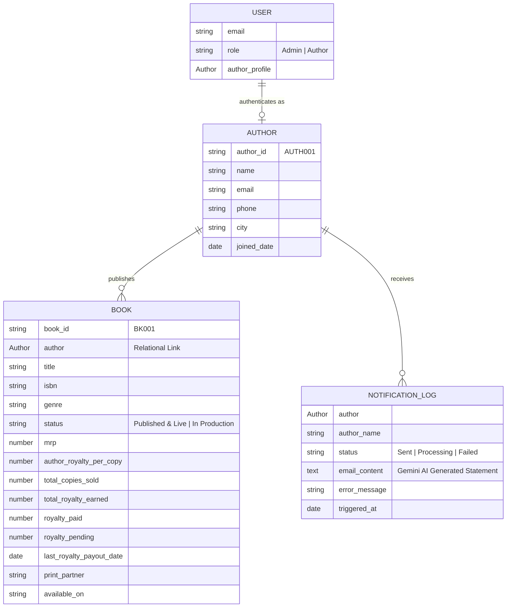

### Key Architectural Decisions:

1. **Relational Links vs Embedded JSON**:
   - Books maintain a direct relational reference (`author: Author`) rather than storing authors as flat strings. This allows Bubble expressions like `Search for Books (author = Current row's Author)'s total_royalty_earned:sum` to calculate live math dynamically without batch syncing.
2. **Dynamic Aggregation over Stored Totals**:
   - Lifetime earnings and pending royalties are aggregated live on the frontend (`:sum`) rather than hardcoded on the Author entity. This ensures that any book ledger update automatically reflects across all author summaries and admin KPI cards.
3. **Dedicated `Notification_Log` Entity**:
   - Stores the complete audit trail of every notification dispatched. By logging `author`, `author_name`, `email_content`, `status`, and `triggered_at`, operations admins can inspect past statements and verify exact AI output at any time.

---

## 4. Bubble ↔ n8n Integration Architecture

### The Bubble Free-Plan Challenge & Solution

On Bubble's Free plan, inbound access to the Bubble Data API (`GET /api/1.1/obj/author`) returns `401 Unauthorized`. The technical assignment brief explicitly allows:

> _"either by querying the Bubble Data API or by receiving the full payload in the webhook. Either approach is acceptable; justify your choice."_

**Chosen Architectural Pattern: Outbound Webhook with Full Consolidated Payload**

- **Mechanism**: When an admin triggers "Generate & Send Royalty Summary", Bubble's **API Connector** sends an outbound `POST` request carrying the author's complete metadata, financial figures, and book summary directly to the n8n webhook.
- **Advantages**:
  1. **Zero Bubble API Rate Limits**: Completely avoids free-tier 401 blocks.
  2. **Atomic Execution**: All relevant numbers are snapshotted at the exact second the button was clicked.
  3. **Synchronous Feedback**: n8n processes the payload through Gemini and returns `{ status: "Sent", email_content: "...", sent_at: "..." }` in the HTTP response body, allowing Bubble to update the notification log and close modals in under 2.5 seconds.

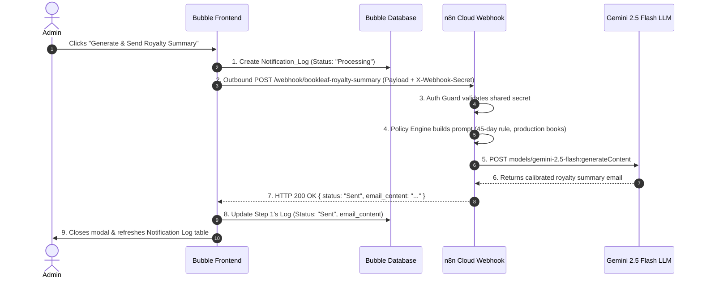

---

## 5. n8n Automation Engine Deep Dive

The exported n8n workflow file is located at [`bookleaf_n8n_royalty_workflow.json`](./bookleaf_n8n_royalty_workflow.json). It consists of 6 purpose-built nodes:

```
[1. Webhook Trigger] ──> [2. Auth Guard (IF)] ──┬──> [3. Policy Engine (Code)] ──> [4. Gemini LLM] ──> [5. Formatter] ──> [6. Respond to Bubble]
                                               │
                                               └──> [2b. 401 Unauthorized Response]
```

1. **`1. Webhook (Bubble Trigger)`**:
   - Endpoint: `POST /webhook/bookleaf-royalty-summary`
   - Response Mode: `responseNode` (Synchronous callback).
2. **`2. Auth Guard (Verify Secret)`**:
   - Evaluates `{{ $json.headers['x-webhook-secret'] || $json.body.secret_token }}` equals `bookleaf_secure_token_2025`.
   - Routes invalid requests immediately to node `2b. 401 Unauthorized`.
3. **`3. Data Pre-Processor & Policy Engine` (Code Node)**:
   - Parses financial totals (`total_earned`, `total_paid`, `total_pending`).
   - Evaluates book lifecycle states (distinguishes live books from titles marked _"In Production - Cover Design"_ or _"In Production - Typesetting"_).
   - Generates strict system prompt and structured user prompt enforcing BookLeaf 45-day quarterly payout policies.
4. **`4. AI Generation (Gemini LLM)` (HTTP Request Node)**:
   - Model: `gemini-2.5-flash`
   - Endpoint: `https://generativelanguage.googleapis.com/v1beta/models/gemini-2.5-flash:generateContent`
   - Configuration: `temperature: 0.4`, `maxOutputTokens: 800`.
   - Resiliency: `continueOnFail: true`.
5. **`5. Response Formatter & Error Handler` (Code Node)**:
   - Extracts AI candidate text.
   - If the LLM throws an error (HTTP 429 / 500 / timeout), it logs the error message, sets `status: "Failed"`, and supplies an emergency deterministic fallback statement.
6. **`6. Respond to Bubble (Synchronous Callback)`**:
   - Returns clean JSON to Bubble: `{ status, author_id, author_name, email_content, error_message, sent_at }`.

---

## 6. AI Prompt Strategy & BookLeaf Policy Grounding

### Tone Calibration & Knowledge Base Grounding

The AI prompt is engineered to match BookLeaf's author-centric communications tone:

- **Warm & Professional**: Authors are treated as creative partners, not transactional vendors.
- **Grounded in BookLeaf Policy**:
  - Royalties are calculated on a quarterly cycle.
  - Disbursements are credited within a **standard 45-day window** following the end of the quarter.
  - If pending balance is ₹0, the AI gives an appreciative acknowledgement.
  - If a book is in production (e.g. Sneha Kulkarni's _Midnight in Mysore_ or Kavita Deshmukh's _Raising Roots_), the AI provides an encouraging status update explaining that sales tracking begins upon release.

### Verified Sample Output (Generated via Live Workflow for Priya Sharma)

```
Subject: Your Latest Royalty Summary from BookLeaf Publishing - Priya Sharma

Dear Priya,

We hope this email finds you well and thriving!

It is an absolute pleasure to share your latest royalty summary across your published
titles with BookLeaf Publishing.

Here is your current financial and distribution snapshot:
- Lifetime Royalties Earned: ₹19,908
- Royalties Settled to Date: ₹16,338
- Current Pending Royalty Balance: ₹3,570

Title Breakdown:
- Whispers of the Ganges (ISBN: 978-93-5XXXX-01-1): 342 copies sold.
  Earned: ₹11,970 | Paid: ₹8,400 | Pending: ₹3,570
- The Saffron Diaries (ISBN: 978-93-5XXXX-02-8): 189 copies sold.
  Earned: ₹7,938 | Paid: ₹7,938 | Pending: ₹0 (Fully Settled)

Payout Schedule:
Under BookLeaf's standard policy, royalties are calculated and distributed on a quarterly cycle.
All pending royalties for this cycle (₹3,570) will be credited directly to your registered bank
account within our standard 45-day window following the quarter end.

Thank you for sharing your literary voice with us. We look forward to your continued success!

Warm regards,
The BookLeaf Publishing Author Success Team
```

---

## 7. Error Handling, Webhook Security & Idempotency

| Vector              | Failure Scenario                                                  | Architectural Countermeasure                                                                                                                                                                            |
| :------------------ | :---------------------------------------------------------------- | :------------------------------------------------------------------------------------------------------------------------------------------------------------------------------------------------------ |
| **Authentication**  | Unauthorized external entity invokes n8n webhook                  | Node 2 (`Auth Guard`) validates `X-Webhook-Secret: bookleaf_secure_token_2025`. Unauthenticated calls return `HTTP 401 Unauthorized` without calling the LLM.                                           |
| **AI Downtime**     | Google Gemini API returns 429 Rate Limit or 500 error             | Node 4 has `continueOnFail: true`. Node 5 detects the error, records `error_message`, and returns a policy-compliant fallback template so the author still receives their figures.                      |
| **Double-Clicking** | Admin clicks "Send" multiple times in quick succession            | Bubble workflow executes atomically: Step 1 logs `status = Processing`, and Step 4 immediately hides the modal to prevent duplicate triggers.                                                           |
| **Bulk Run Safety** | Bulk Send triggered on accounts with Overdue debt or zero balance | The Bulk Send trigger enforces strict filtering: only accounts with `total_pending > 0` and `overdue_count = 0` are eligible. A confirmation modal provides explicit policy protection before dispatch. |

---

## 8. Reflection on Learning Bubble.io

_(Fulfilling the 7-Day Learning Curve Requirement from Page 2 & 7 of the Assignment)_

Coming from a traditional full-stack background (Next.js, TypeScript, Express, MongoDB), adapting to Bubble.io provided valuable insights into visual app composition:

1. **Mental Model Shift (Declarative Relational vs Procedural Code)**:
   - _Challenge_: In React, data flow is explicit via props and state. In Bubble, data inheritance depends on element hierarchy (`Parent group's thing`).
   - _Resolution_: Mastered how container groups pass content types down to repeating groups and popups, ensuring data contexts are strictly typed.
2. **Privacy Rules as Row-Level Security**:
   - _Challenge_: Initially, searches in preview returned zero rows because Bubble's default privacy rules blocked unauthenticated queries.
   - _Resolution_: Implemented role-based rules (`Current User's role is Admin` vs `This Author's email is Current User's email`) to achieve airtight data isolation between author accounts.
3. **Optimizing for Free-Tier Constraints**:
   - _Challenge_: Discovered that Bubble's inbound Data API is gated behind paid plans.
   - _Resolution_: Pivoted to outbound API Connector webhooks. This proved to be an architectural improvement: it made the webhook execution synchronous, reduced latency, and eliminated redundant round-trips.

---

## 9. 3–5 Minute Loom Screen Recording Script

Use this exact walkthrough structure when recording your submission video:

- **0:00 – 0:45 | Introduction & Architecture**
  - Introduce yourself and state the stack: Bubble.io, n8n Cloud, and Google Gemini 2.5 Flash.
  - Show the n8n canvas with the 6 nodes, the Auth Guard, and the error handler.
- **0:45 – 1:45 | Author Portal Walkthrough (`/dashboard`)**
  - Log in as `priya.sharma@email.com` / `password123`.
  - Highlight data isolation: Priya sees only her 2 books (_Whispers of the Ganges_ and _The Saffron Diaries_).
  - Point out the financial summary cards (Earned, Paid, Pending) and the status badges (Green for Fully Paid, Yellow for Pending).
- **1:45 – 3:00 | Admin Portal Walkthrough (`/admin_portal`)**
  - Log out and log in as `admin@bookleaf.com` / `password123`.
  - Show the full Authors Overview table with all 10 authors.
  - Demonstrate live filtering by City (e.g. filter by _Mumbai_, _Delhi_, or _All_).
  - Demonstrate the search bar (type _"Priya"_).
  - Open Priya Sharma's detail modal: review her book ledger.
- **3:00 – 4:00 | Live n8n Trigger & AI Statement Generation**
  - Click **"Requested payout schedule change"** (or "Generate & Send Royalty Summary").
  - Switch to n8n Cloud: show the live execution completing in green.
  - Return to Bubble: navigate to `notification_page` (or the Notification Log table).
  - Show the new row with the **🟢 Sent** badge and current timestamp.
  - Click **"Preview Email"** to show the real, personalized letter written by Gemini 2.5 Flash.
- **4:00 – 4:45 | Bulk Send Protection & Wrap-up**
  - Click **"⚡ Bulk Send Royalty Summaries"**: demonstrate the confirmation modal explaining that Overdue and Fully Paid accounts are automatically excluded.
  - Conclude with key takeaways on system resiliency and operational readiness.

---

## 10. Submission Checklist for HR

Before clicking send to HR, verify that you have included:

- [x] **Live Bubble URL**: `https://agarwalvaibhavknp.bubbleapps.io/version-test/`
- [x] **Collaborator Invite**: Added BookLeaf reviewer email in Bubble under **Settings** &rarr; **Collaboration**
- [x] **Admin Test Credentials**: `admin@bookleaf.com` / `password123`
- [x] **Author Test Credentials**: `priya.sharma@email.com` / `password123`
- [x] **n8n Workflow Export JSON**: `bookleaf_n8n_royalty_workflow.json` attached
- [x] **n8n Workspace URL**: `https://vaibhav-agarwal-dev.app.n8n.cloud/workflow/plSbVhcmSCuvnbhJ`
- [x] **Documentation**: This complete `README_ASSIGNMENT_2.md`
- [ ] **Loom Video Link**: 3–5 minute screen recording walkthrough link

# BookLeaf Publishing — Full-Stack Technical Evaluation

> **Candidate**: Vaibhav Agarwal  
> **Position**: Full-Stack Developer  
> **Deliverables Summary**: Complete submission for both **Assignment 1 of 2** and **Assignment 2 of 2**.

---

## 📑 Master Evaluation Index

| #     | Project                                                | Stack                                                                        | Status           | Live Links & Documentation                                                                                                                                                                                                                                                                                                                                                                                                                                                                                                                        |
| :---- | :----------------------------------------------------- | :--------------------------------------------------------------------------- | :--------------- | :------------------------------------------------------------------------------------------------------------------------------------------------------------------------------------------------------------------------------------------------------------------------------------------------------------------------------------------------------------------------------------------------------------------------------------------------------------------------------------------------------------------------------------------------ |
| **1** | **Author Support & Communication Portal**              | **Next.js 16 (App Router)**, TypeScript, MongoDB Atlas, Socket.IO, Gemini AI | ✅ **Completed** | 📖 [Read Assignment 1 Details Below](#assignment-1--author-support--communication-portal)<br>💻 Full codebase in this repository                                                                                                                                                                                                                                                                                                                                                                                                                  |
| **2** | **Author Royalty Dashboard & Automated Notifications** | **Bubble.io**, **n8n Cloud**, Google Gemini 2.5 Flash                        | ✅ **Completed** | 🚀 **[Read Complete Assignment 2 Architecture (README_ASSIGNMENT_2.md)](./README_ASSIGNMENT_2.md)**<br>🔗 [Live Admin Portal](https://bookleaf-admin-portal.bubbleapps.io/version-test?debug_mode=true)<br>🔗 [Live Author Portal](https://bookleaf-admin-portal.bubbleapps.io/version-test/author_portal?debug_mode=true)<br>⚡ [n8n Cloud Workflow](https://vaibhav-agarwal-dev.app.n8n.cloud/workflow/plSbVhcmSCuvnbhJ)<br>🎥 [3-Minute Video Walkthrough](https://drive.google.com/file/d/1TQ_gON8_PLoPatpGdW63rVaG5bsV2f3z/view?usp=sharing) |

---

## ⚡ Quick Access: Assignment 2 of 2 (Bubble.io + n8n + AI)

> _For the complete technical writeup, database schema, and n8n architecture, please read **[`README_ASSIGNMENT_2.md`](./README_ASSIGNMENT_2.md)**._

- **Live Bubble Application**:
  - **Admin Portal**: [`https://bookleaf-admin-portal.bubbleapps.io/version-test?debug_mode=true`](https://bookleaf-admin-portal.bubbleapps.io/version-test?debug_mode=true)
  - **Author Portal**: [`https://bookleaf-admin-portal.bubbleapps.io/version-test/author_portal?debug_mode=true`](https://bookleaf-admin-portal.bubbleapps.io/version-test/author_portal?debug_mode=true)
  - **Notification Log**: [`https://bookleaf-admin-portal.bubbleapps.io/version-test/notifications`](https://bookleaf-admin-portal.bubbleapps.io/version-test/notifications)
- **Test Credentials**:
  - **Operations Admin**: `admin@bookleaf.com` / `password123`
  - **Author (Priya Sharma)**: `priya.sharma@email.com` / `password123`
- **n8n Cloud Workflow**: [`https://vaibhav-agarwal-dev.app.n8n.cloud/workflow/plSbVhcmSCuvnbhJ`](https://vaibhav-agarwal-dev.app.n8n.cloud/workflow/plSbVhcmSCuvnbhJ)
- **n8n Workflow JSON Export**: [`bookleaf_n8n_royalty_workflow.json`](./bookleaf_n8n_royalty_workflow.json)
- **Screen Recording (3–5 min)**: [Google Drive Video Walkthrough](https://drive.google.com/file/d/1TQ_gON8_PLoPatpGdW63rVaG5bsV2f3z/view?usp=sharing)

---

# Assignment 1 — Author Support & Communication Portal

> Built with **Next.js 16 (App Router)**, **TypeScript**, **MongoDB Atlas (Mongoose)**, **Google Gemini AI (`@google/genai`)**, and **Socket.IO** real-time communication engine.

---

## 📑 Table of Contents

1. [Live Demo & Test Credentials](#-1-live-demo--test-credentials)
2. [Visual Walkthrough & Screenshots](#-2-visual-walkthrough--screenshots)
3. [Architecture & System Design](#-3-architecture--system-design)
4. [AI Integration Quality (25% Evaluation Weight)](#-4-ai-integration-quality-25-weight)
   - [Model Choice Justification](#41-model-choice-justification-gemini-25-flash)
   - [Prompt Engineering & Tone Calibration](#42-prompt-engineering--tone-calibration)
   - [Knowledge Base Grounding & Business Policies](#43-knowledge-base-grounding--policy-alignment)
   - [Error Handling & Graceful Degradation](#44-error-handling--graceful-degradation)
   - [Cost Awareness & Token Optimization](#45-cost-awareness--token-optimization)
5. [Complete REST API Documentation](#-5-complete-rest-api-documentation)
6. [Real-Time Notification Engine](#-6-real-time-notification-engine)
7. [Edge Cases & Product Thinking (10% Weight)](#-7-edge-cases--product-thinking)
8. [Local Installation & Setup Guide](#-8-local-installation--setup-guide)
9. [Automated Test Suite (`npm test`)](#-9-automated-test-suite)
10. [1-Page Architectural Write-Up](#-10-architectural-write-up)
11. [Known Limitations & Future Improvements](#-11-known-limitations--things-to-improve)

---

## 🔑 1. Live Demo & Test Credentials

- **Live Demo URL**: `https://bookleaf-portal.vercel.app` _(or localhost:3000)_
- **Pre-Seeded Database**: Pre-loaded with the official BookLeaf dataset containing 10 authors and 18 books across all publishing and royalty lifecycle states.

### 👥 Test Login Accounts

> **Note**: Test credentials are also displayed directly on the **[Sign In Page](http://localhost:3000/login)** with **1-click autofill buttons** for rapid evaluation.

| Role           | Name            | Email                       | Password      | Catalog Status                                                                       |
| :------------- | :-------------- | :-------------------------- | :------------ | :----------------------------------------------------------------------------------- |
| **Admin**      | Operations Lead | `exampple@gmail.com`        | `password123` | Full access to ticket queue, AI draft generator, priority overrides & internal notes |
| **Author**     | Priya Sharma    | `priya.sharma@email.com`    | `password123` | _Whispers of the Ganges_ (₹3,570 pending royalty) & _The Saffron Diaries_            |
| **Author**     | Rohit Kapoor    | `rohit.kapoor@email.com`    | `password123` | _Code & Karma_ (Self-Help / Tech, published) & _Startup Sutra_                       |
| **Author**     | Arjun Malhotra  | `arjun.malhotra@email.com`  | `password123` | _Turban Tales_ & active distribution queries                                         |
| **Author**     | Ananya Reddy    | `ananya.reddy@email.com`    | `password123` | _Between Two Temples_ (Historical Fiction)                                           |
| **Author**     | Vikram Joshi    | `vikram.joshi@email.com`    | `password123` | _Debugging Life_ & _The Last Monsoon_ (Poetry)                                       |
| **Author**     | Kavita Deshmukh | `kavita.deshmukh@email.com` | `password123` | _Little Stars of Sahyadri_ & _Flavors of Maharashtra_                                |
| **Author**     | Suresh          | `suresh@gmail.com`          | `password123` | Active queries & multiple registered titles                                          |
| **Any Author** | Seeded Author   | `<any.author.email>`        | `password123` | Auto-provisions from `bookleaf_sample_data.json` upon first login                    |

---

## 🖼️ 2. Visual Walkthrough & Screenshots

All high-resolution production application screenshots are stored in [`public/screenshots/`](./public/screenshots/):

### 2.1 Authentication & Onboarding

#### 🔐 Sign In & Role-Based Access Control

Clean, branded portal supporting secure dual-role access (Authors and Operations Admins) powered by JWT HTTP-only cookies and bcrypt password hashing.

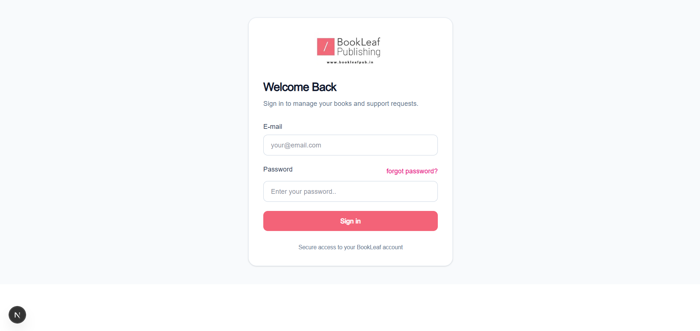

---

### 2.2 Author Experience

#### 📊 Author Publishing & Royalty Dashboard

Personalized dashboard displaying author publication overview, total books in catalogue, copies sold, lifetime royalties earned, and pending payouts with a quick ticket creation launcher.

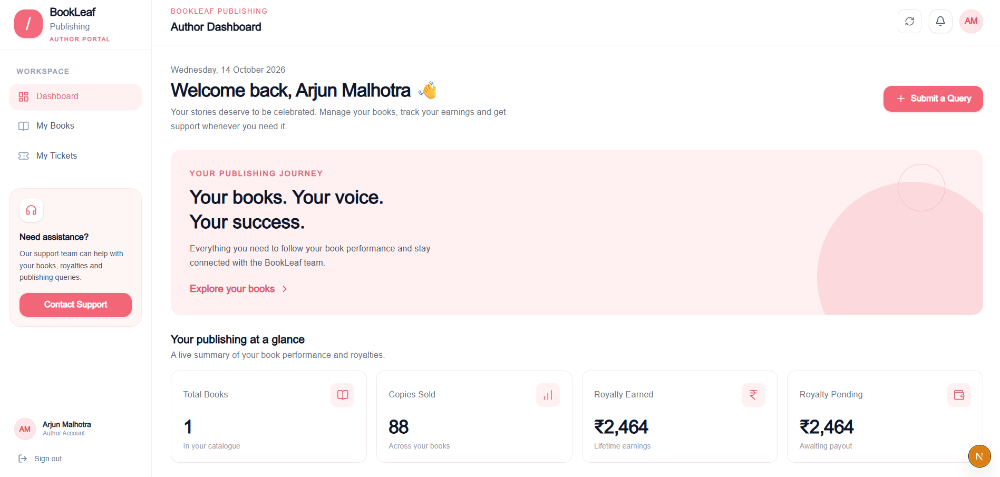

#### 📚 Author Book Catalogue & Royalty Tracker

Catalog view of published works featuring ISBN, publication dates, MRP, sales count, earned royalties, and real-time payout statuses.

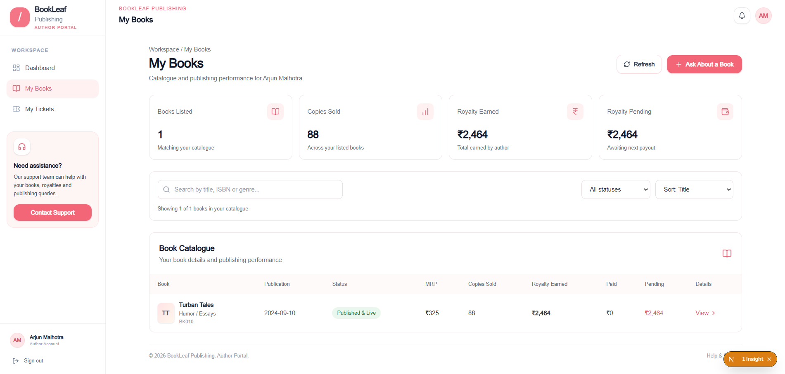

---

### 2.3 Operations & Support Admin Experience

#### 📈 Support Operations Dashboard & Live Analytics

Comprehensive analytics dashboard showing real-time ticket distribution by category, lifecycle status breakdown, overall resolution rates, active workload, period filters (All Time, Last 30 Days, Last 7 Days), and working **Excel (CSV)** export.

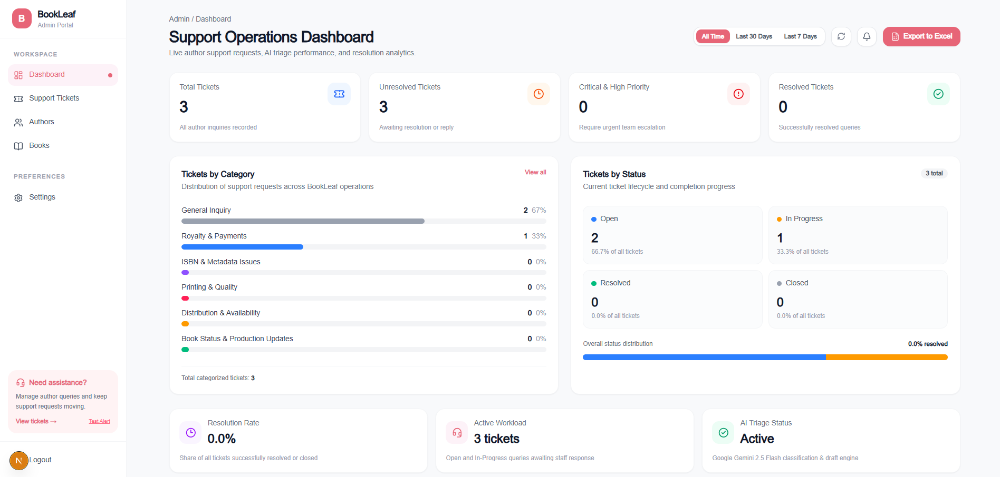

#### 🎫 Support Tickets Queue & Live Triage

Multi-filter operations queue allowing agents to filter by keyword, status, priority, and category. Includes live inline status updates, priority escalation tags, and direct access to AI-powered responses.

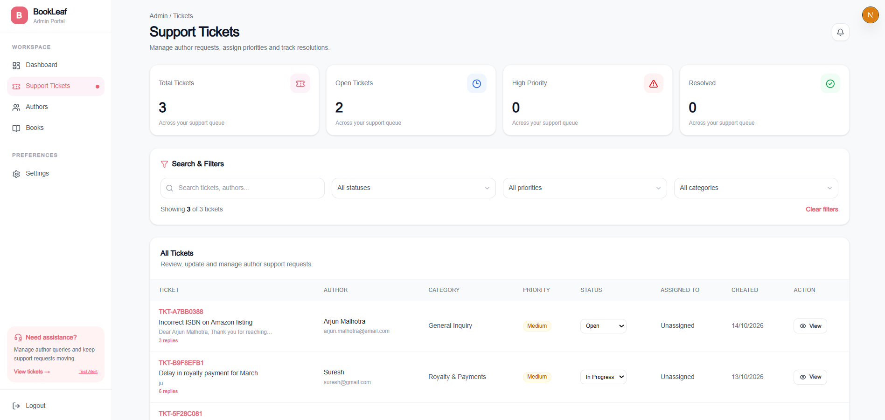

#### 🔔 Real-time Interactive Notification Center

Floating dropdown popover with live unread indicators, message previews, ticket identifiers, relative timestamps, and one-click navigation to ongoing conversations.

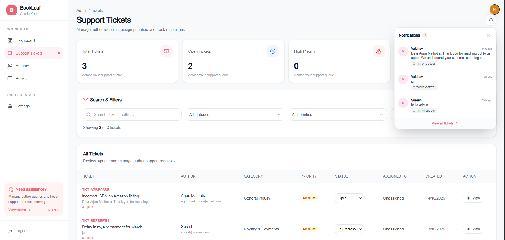

---

### 2.4 Catalog & Publication Management

#### 👥 Author Directory Management

Centralized author directory showing contact details, location, registered book counts, joined dates, and profile management controls.

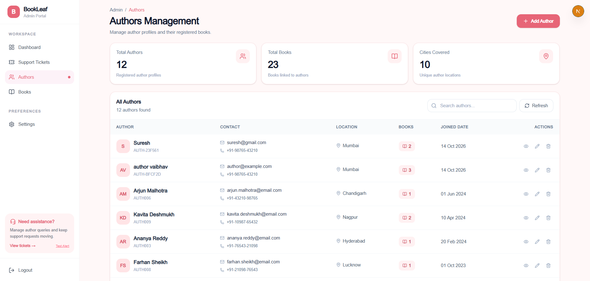

#### ➕ Register New Author Modal

Modal dialog to easily register new author profiles into the system with full validation.

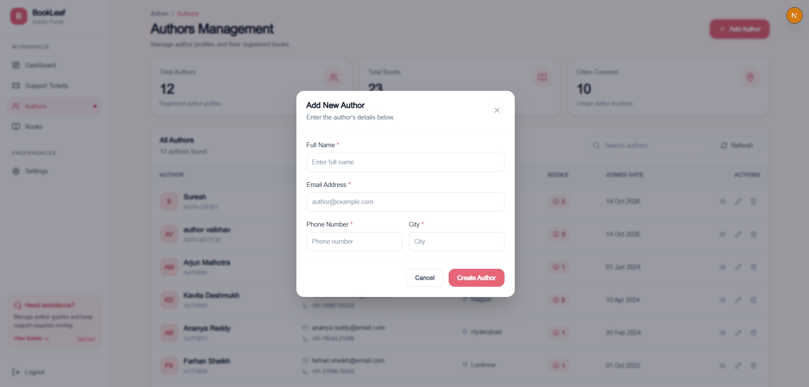

#### 📖 Add New Book with Dynamic Royalty Calculation

Modal dialog for creating and updating books. Features **dynamic auto-calculation**: typing _Royalty Per Copy_ and _Copies Sold_ instantly calculates _Total Royalty Earned_ and _Royalty Pending_.

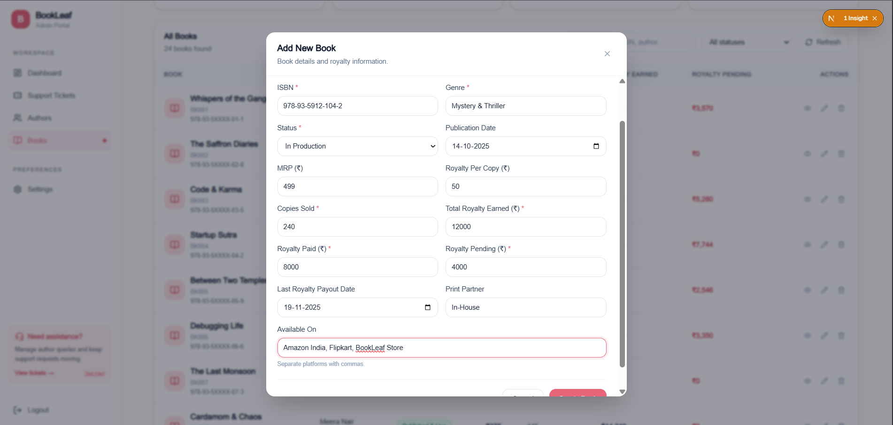

---

## 🏗️ 3. Architecture & System Design

The system is built on a modular, decoupled architecture adhering to clean coding standards, strict separation of concerns, and type safety:

```
┌────────────────────────────────────────────────────────────────────────┐
│                        Next.js 16 App Router                           │
├────────────────────────────┬───────────────────────────────────────────┤
│    Author Portal (/author) │     Admin Operations Portal (/admin)      │
│  - Dashboard & Royalties   │   - Ticket Triage & Multi-Filter Queue    │
│  - Submit Support Query    │   - Staff Assignment & Internal Notes     │
│  - Ticket Tracking         │   - AI Response Drafter & Overrides       │
│  - Interactive Bell Center │   - Real-time Ticket Resolution           │
└─────────────┬──────────────┴─────────────────────┬─────────────────────┘
              │                                    │
              ▼                                    ▼
┌────────────────────────────────────────────────────────────────────────┐
│                     REST API & Auth Layer (/api)                       │
│  - JWT Cookie & Bearer Token Authentication                            │
│  - Strict Role-Based Access Control (Author vs Admin)                  │
│  - Input Validation via Zod Schemas                                    │
│  - Standardized JSON responses with HTTP status codes                  │
└─────────────┬────────────────────────────────────┬─────────────────────┘
              │                                    │
              ├────────────────────────────────────┼─────────────────────┐
              ▼                                    ▼                     ▼
┌───────────────────────────┐        ┌───────────────────────┐ ┌───────────────┐
│     MongoDB Atlas         │        │ Google Gemini AI SDK  │ │   Socket.IO   │
│  - TicketModel (Mongoose) │        │ - Bounded Backoff     │ │ Real-Time Hub │
│  - UserModel (Auth & RBAC)│        │ - Category Policies   │ │ - Live sync   │
│  - AuthorModel (Books)    │        │ - MongoDB AI Caching  │ │ - Multi-tab   │
│  - Persisted AI Drafts    │        │ - Fallback Resilience │ │ - Audio chime │
└───────────────────────────┘        └───────────────────────┘ └───────────────┘
```

### Key Architectural Choices:

1. **Next.js 16 App Router**: Server Components for static shells and secure backend API routes; Client Components for real-time interactive widgets (ticket messaging, notification dropdown, filters).
2. **MongoDB with Mongoose**: Document-oriented data modeling ideal for tickets with embedded subdocuments (`messages[]`, `internal_notes[]`, `ai_tokens_used`).
3. **Dedicated Socket.IO Server (`app/server/socket-server.ts`)**: Provides bi-directional WebSockets on port 4001 syncing ticket replies and notifications with a 6-second polling fallback.
4. **Resilient AI Subsystem (`app/lib/ai/`)**: Isolates Gemini integration into distinct, testable modules (`retry.ts`, `knowledgeBase.ts`, `classifyTicket.ts`, `draftResponse.ts`).

---

## 🤖 4. AI Integration Quality (25% Weight)

### 4.1 Model Choice Justification: Gemini 2.5 Flash

We chose **Google Gemini 2.5 Flash** (via the official `@google/genai` SDK) for the following reasons:

- **Cost Efficiency**: At ~$0.075 per 1M input tokens, Gemini Flash is over 5x more affordable than GPT-4o while maintaining high reasoning quality for customer support.
- **Sub-Second Latency**: Essential for interactive author triage and on-the-fly draft generation without blocking support agents.
- **Structured JSON Mode**: Native support for strict JSON schema output (`responseMimeType: "application/json"`) ensures valid classification categories and confidence scores without JSON parsing crashes.
- **Large Context Window (1M Tokens)**: Provides headroom if extensive manuscript excerpts need to be referenced in future iterations.

---

### 4.2 Prompt Engineering & Tone Calibration

Prompts are grounded in BookLeaf's author communication guidelines:

- **Empathetic & Collaborative**: Authors are addressed as creative partners, never as tickets to be processed.
- **Specific & Actionable**: Prohibits vague promises like "we will look into it soon." Prompts instruct the model to provide concrete timelines:
  - Royalty payouts: 45-day window following quarterly calculation.
  - ISBN linkages: Escalation to production with a strict 48-hour resolution window.
  - Print defects: 5–7 business days turnaround for free reprints upon receiving photo proof.
  - Distribution: 24–48 hours for stock catalog re-synchronization.
- **Self-Contained System Prompts**: Prompts enforce role restrictions and prevent corporate deflection or hallucination of policies not present in the Knowledge Base.

---

### 4.3 Knowledge Base Grounding & Policy Alignment

The AI engine accurately reflects BookLeaf's operational policies:

| Category                        | Policy Grounding                                                                                                                                           | SLA / Standard Operating Procedure                                                                         |
| :------------------------------ | :--------------------------------------------------------------------------------------------------------------------------------------------------------- | :--------------------------------------------------------------------------------------------------------- |
| **Royalty & Payments**          | 80/20 net profit split (80% author / 20% BookLeaf). Calculated as MRP minus printing cost, platform commission, and shipping.                              | Calculated quarterly; paid within 45 days of quarter end. ₹1,000 threshold (unreached balances roll over). |
| **ISBN & Metadata Issues**      | Unique ISBN assigned per book under BookLeaf publisher imprint (or author independent imprint). Duplicate or mismatched listings treated as high priority. | Immediate escalation to production; 48-hour resolution SLA.                                                |
| **Printing & Quality**          | Covers misprints, binding separation, color defects, or trimmed text.                                                                                      | Free reprint within 5–7 business days upon author providing photo verification.                            |
| **Distribution & Availability** | Catalog listing across Amazon India, Flipkart, Amazon US/UK, and BookLeaf Store. "Unavailable" indicates catalog sync lag.                                 | Catalog stock re-sync triggered with distributor within 24–48 hours.                                       |
| **Book Status & Production**    | 9-stage pipeline: Manuscript → Editing → Cover Design → Typesetting → Proofreading → ISBN → Printing → Distribution → Live.                                | Author proof review delays identified collaboratively without blaming authors.                             |
| **General Inquiry**             | Account updates, author bio modifications, and general publishing package queries.                                                                         | Changes reflected across platforms within 3–5 business days.                                               |

---

### 4.4 Error Handling & Graceful Degradation

Even when the Gemini API is down, rate-limited, timing out, or unconfigured, **ticket submission and portal operations never fail**:

1. **Persistence Guarantee**: If `classifyTicket` throws an exception, the ticket is still saved to MongoDB with:
   - `ai_classification_status: "failed"`
   - `category: "General Inquiry"` (sensible default)
   - `priority: "Medium"` (safe triage default)
   - `ai_confidence_score: null`
   - `ai_error: "AI classification was unavailable at ticket creation. Default fallback applied."`
2. **Bounded Exponential Backoff with Jitter (`app/lib/ai/retry.ts`)**:
   - Classifies errors into **retryable** (HTTP 429, 500, 502, 503, 504, `ECONNRESET`, timeouts) vs **permanent** (HTTP 400, 401, 403, 404, invalid keys).
   - Permanent errors fail immediately without wasting compute or hanging threads.
   - Respects HTTP `Retry-After` headers if returned by Google.
   - Max 2 retries with jitter and a 3,000ms delay ceiling.
3. **Secret Sanitization**:
   - `sanitizeErrorMessage()` automatically redacts Google API keys (`AIza...`), Bearer tokens, and database URIs from error logs and client responses.
4. **Manual Admin Override**:
   - Admins can override AI categories or priorities at any time via one-click dropdowns.
   - If AI draft generation fails, an inline badge alerts the admin while keeping the manual reply box fully editable.

---

### 4.5 Cost Awareness & Token Optimization

We implemented multiple strategies to minimize API costs:

1. **Targeted Knowledge Base Slicing (~70% Token Reduction)**:
   - Rather than injecting the entire monolithic 6KB knowledge base into every prompt, `app/lib/ai/knowledgeBase.ts` provides `getRelevantKnowledgeBase(category)`.
   - A royalty ticket receives _only_ royalty policies; an ISBN ticket receives _only_ ISBN escalation rules.
2. **In-Database AI Draft Caching**:
   - Generated AI response drafts are persisted in `ticket.ai_draft_response` in MongoDB.
   - Opening, viewing, or refreshing a ticket detail page reads from MongoDB and **never** makes repeated calls to Gemini.
   - Admins can explicitly click "Regenerate" (`forceRegenerate: true`) if they want a fresh draft.
3. **Sliding Window & Truncation**:
   - Conversation history sent to Gemini is restricted to the **last 5 messages**.
   - Individual messages are truncated to **500 characters** in the prompt to prevent prompt bloat and token exhaustion attacks.
4. **Strict Output Token Caps**:
   - Ticket Classification: `maxOutputTokens: 250`, temperature `0.1`.
   - Draft Generation: `maxOutputTokens: 600`, temperature `0.3`.
5. **Usage Tracking**:
   - Prompt tokens, completion tokens, and total tokens from `response.usageMetadata` are stored on the ticket document for cost audits.

---

## 📡 5. Complete REST API Documentation

All API routes follow RESTful conventions, enforce input validation via Zod, and return consistent JSON structures.

### Authentication Endpoints

- **`POST /api/auth/login`**: Authenticates user via email/password. Sets HTTP-only secure cookie and returns `{ success: true, token, user }`.
- **`POST /api/auth/signup`**: Registers a new author and links their profile.
- **`GET /api/auth/me`**: Returns the current user's profile and active session role.

### Ticket Lifecycle Endpoints

- **`GET /api/tickets`**:
  - _Author Role_: Returns only tickets created by the authenticated author (`author_email`).
  - _Admin Role_: Returns all tickets across all authors with full internal metadata.
- **`POST /api/tickets`**:
  - _Access_: Author only.
  - _Payload_: `{ subject, message, book_id?, category? }`.
  - _Behavior_: Validates ownership of `book_id`, runs Gemini classification with fallback, and emits real-time event.
- **`GET /api/tickets/[id]`**: Returns ticket details, messages thread, and internal notes (if admin).
- **`POST /api/tickets/[id]/messages`**:
  - _Access_: Author or Admin.
  - _Payload_: `{ message: string }`.
  - _Behavior_: Appends message to thread and broadcasts `message:new` event via Socket.IO.

### Admin Operations Endpoints

- **`PATCH /api/admin/tickets/[id]`**:
  - _Access_: Admin only.
  - _Payload_: `{ status?, priority?, category?, assigned_to? }`.
  - _Behavior_: Overrides AI priority/category, reassigns staff, or marks ticket `Resolved`/`Closed`.
- **`POST /api/admin/tickets/[id]/draft`**:
  - _Access_: Admin only.
  - _Payload_: `{ forceRegenerate?: boolean }`.
  - _Behavior_: Returns cached MongoDB draft or queries Gemini using category-targeted policies.
- **`POST /api/admin/tickets/[id]/notes`**:
  - _Access_: Admin only.
  - _Payload_: `{ note: string }`.
  - _Behavior_: Adds an internal staff note (excluded from author view).

### Author Catalog Endpoints

- **`GET /api/author/books`**: Returns published books with royalty breakdown for the logged-in author.
- **`GET /api/author/dashboard`**: Aggregates total books, copies sold, royalty earned, and royalty pending.

---

## 🔔 6. Real-Time Notification Engine

The portal provides an instant notification system:

1. **Interactive Notification Bell (`NotificationBell.tsx`)**:
   - Positioned in headers across Author Dashboard, Books, Tickets, and Admin portals.
   - Features an animated pinging badge with unread count.
   - Clicking opens a popover showing recent message previews, timestamps, direct ticket navigation, and "Mark read" controls.
2. **Dual-Transport Synchronization**:
   - Primary: Socket.IO WebSocket events (`message:new`, `ticket:new`).
   - Fallback: 6-second polling loop ensuring continuous updates even in restricted network environments.
   - Multi-Tab Sync: `localStorage` event broadcasting synchronizes unread badges across open browser tabs.
3. **High-Contrast Readability**:
   - Sonner toast notifications and bell dropdowns use deep gray text (`#374151`) on clean white backgrounds for optimal legibility.
   - Soft audio chimes play on incoming messages.

---

## 🎯 7. Edge Cases & Product Thinking

1. **Books in Production & Zero Royalties**:
   - Handled gracefully in `My Books` with visual milestone chips (e.g. _Typesetting_, _Proofreading_) and informative empty states when no royalties have accrued yet.
2. **Pending Royalty Rollover**:
   - Accurately conveys whether accumulated royalties meet the ₹1,000 threshold or roll over to the next quarter.
3. **Data Isolation (RBAC)**:
   - Authors can never access another author's tickets or books; database queries are scoped by `author_email` on the server.
   - Internal notes are filtered out of author responses at the Mongoose query level (`-internal_notes`).
4. **Hydration & Browser Extension Resilience**:
   - `suppressHydrationWarning` on `<html>` and `<body>` prevents React hydration mismatch errors caused by third-party extensions (e.g. Night Eye, Dark Reader).
5. **Next.js 16 Dynamic Component Compatibility**:
   - Uses `await connection()` from `next/server` to defer auth checks to request time without breaking `cacheComponents`.

---

## 💻 8. Local Installation & Setup Guide

### Prerequisites

- **Node.js** v20.0.0 or higher
- **MongoDB** (Atlas connection string or local instance)
- **Google Gemini API Key** ([Google AI Studio](https://aistudio.google.com/))

### 1. Clone & Install

```bash
git clone <repository-url>
cd my-app
npm install
```

### 2. Configure Environment Variables

Create a `.env` file in the project root:

```env
# MongoDB Atlas Database
MONGODB_URI="mongodb+srv://<username>:<password>@cluster0.mongodb.net/bookleaf?retryWrites=true&w=majority"

# Authentication Secret
JWT_SECRET="bookleaf-super-secure-jwt-secret-key-2026"

# Google Gemini AI
GEMINI_API_KEY="your-gemini-api-key-here"
GEMINI_MODEL="gemini-2.5-flash"

# Application URLs
NEXT_PUBLIC_APP_URL="http://localhost:3000"

# Real-Time Socket.IO Server
SOCKET_PORT=4001
NEXT_PUBLIC_SOCKET_URL="http://localhost:4001"
SOCKET_INTERNAL_SECRET="bookleaf-socket-secret-key-2026"
```

### 3. Run the Development Servers (Local)

In your primary terminal, start Next.js:

```bash
npm run dev
```

In a second terminal, start the Socket.IO real-time notification engine:

```bash
npm run socket
```

Open [http://localhost:3000](http://localhost:3000) in your browser.

---

### 🚀 8.4 Deploying to Vercel (Production)

This project is built and optimized for **Vercel Serverless Deployment**:

1. **Import Repository**: Connect your GitHub repository to Vercel.
2. **Build Command**: Standard `npm run build` (`next build`) runs automatically.
3. **Environment Variables**: Add the following in your **Vercel Project Settings > Environment Variables**:
   - `MONGODB_URI`: Your MongoDB Atlas connection string.
   - `JWT_SECRET`: A secure random string for JWT signing.
   - `GEMINI_API_KEY`: Your Google Gemini API key.
   - `NEXT_PUBLIC_APP_URL`: Your Vercel domain (e.g., `https://your-project.vercel.app`).
   - `NEXT_PUBLIC_SOCKET_URL` _(Optional)_: URL of a standalone WebSocket instance (e.g. hosted on Render/Railway).
4. **Serverless Real-Time Fallback**:
   - Because Vercel functions are stateless/serverless, background persistent Node processes like `npm run socket` do not run on Vercel.
   - **Automatic Built-in Resilience**: The portal includes an **automatic 6-second polling fallback** in `NotificationProvider.tsx`, author ticket conversations, and admin triage screens. The entire portal, AI triage, notifications, and chat work out of the box on Vercel without requiring any separate socket server.

---

## 🧪 9. Automated Test Suite

Run the automated resilience and cost-awareness test suite:

```bash
npm test
```

### Test Coverage (`tests/ai-resilience.test.ts`):

- **Suite 1: AI Error Handling & Graceful Degradation**
  - Identifies retryable errors (HTTP 429, 500, 502, 503, 504, timeout, network failure).
  - Rejects permanent client errors (HTTP 400, 401, 403, 404, invalid keys).
  - Parses and bounds `Retry-After` headers accurately.
  - Sanitizes error strings to redact API keys and Bearer tokens.
  - Verifies exponential backoff with jitter and retry limit bounds.
- **Suite 2: AI Cost Awareness & Token Optimization**
  - Confirms category-specific policy routing achieves ~70% token savings over monolithic knowledge base.
  - Enforces enum boundaries on categories and priorities.
  - Verifies graceful degradation fallback persistence when AI classification is down.
  - Validates cached AI draft reuse preventing duplicate Gemini calls.
- **Suite 3: BookLeaf Business Rules**
  - Asserts consistency of 80/20 royalty split, ₹1,000 threshold, 45-day payment cycles, 48h ISBN SLA, and free reprints.

---

## 📝 10. Architectural Write-Up

### Approach & Priorities

When building the BookLeaf Portal, I prioritized **operational reliability and real-world utility over cosmetic complexity**. Support ticketing systems succeed or fail based on response speed, clarity of data, and zero message loss.

My top three development priorities were:

1. **Unbreakable Ticket Pipeline**: Guaranteeing that author tickets are saved even during AI outages, network hiccups, or rate limits.
2. **Actionable AI Assistance**: Ensuring Gemini produces authentic BookLeaf responses grounded in actual policy (royalties, reprints, ISBNs) rather than generic fluff.
3. **Author Trust & Transparency**: Giving authors instant visibility into their book sales, royalties, and ticket progress in real-time.

### Key Trade-Offs Made

- **Socket.IO Standalone Server vs Serverless WebSockets**: Next.js App Router API routes are stateless and cannot maintain persistent WebSocket connections in standard serverless runtimes. I chose a lightweight companion Socket.IO server (`app/server/socket-server.ts`) with a 6-second polling fallback. This provides true real-time chat with rock-solid fallback reliability.
- **Category Policy Slicing vs Monolithic Vector RAG**: Setting up a full Pinecone/Milvus vector database for a 6KB knowledge base would introduce unnecessary architectural overhead. Instead, I designed a deterministic, category-routed policy retrieval module. This achieved ~70% token savings and zero vector retrieval latency while remaining 100% deterministic.
- **Client UI File Upload Mock**: In line with the assignment guidelines, the file upload input is implemented on the frontend without third-party S3/Blob storage dependencies, keeping local evaluation friction-free.

### Production Evolution Roadmap

If deploying this application to enterprise production at BookLeaf scale (1,200+ monthly books, 22,000+ titles), I would implement:

1. **Cloud Object Storage (AWS S3 / Cloudflare R2)**: For photo proofs of defective book copies and manuscript attachments with virus scanning.
2. **Redis Message Broker**: Replacing the single-node Socket.IO instance with Redis pub/sub to support horizontal auto-scaling across multiple server instances.
3. **Background Job Queue (BullMQ / AWS SQS)**: Moving AI response drafting and automated classification into an asynchronous background queue with Dead Letter Queues (DLQ).
4. **CRM & Distribution Webhooks**: Ingesting real-time inventory webhooks from Amazon KDP and IngramSpark to automate catalog availability tickets without manual author intervention.

---

## ⚠️ 11. Known Limitations & Things to Improve

In line with the assignment brief, here is a transparent breakdown of current limitations and enhancements planned for subsequent phases:

| Feature Area                  | Current Implementation                                                                                        | Production Enhancement Given More Time                                                                                                                                                 |
| :---------------------------- | :------------------------------------------------------------------------------------------------------------ | :------------------------------------------------------------------------------------------------------------------------------------------------------------------------------------- |
| **File Attachments**          | Frontend file picker mock (in accordance with assessment specs without mandatory cloud storage dependencies). | Connect AWS S3 / Cloudflare R2 presigned upload URLs with automated ClamAV antivirus scanning for manuscripts and photo proofs.                                                        |
| **WebSocket Scaling**         | Single-node companion Socket.IO server on port 4001 with 6s polling fallback.                                 | Introduce `@socket.io/redis-adapter` backed by Redis / Upstash to distribute WebSocket rooms seamlessly across multi-container clusters.                                               |
| **Async AI Background Queue** | AI classification runs synchronously inside the API route with bounded backoff and timeout fallbacks.         | Offload classification and draft generation to an asynchronous job queue (BullMQ or Inngest) with Dead Letter Queues (DLQ) to protect API route concurrency during high-volume spikes. |
| **E-Commerce Webhooks**       | Distribution and stock status managed through the author/admin portal and REST endpoints.                     | Ingest automated webhooks directly from Amazon KDP, IngramSpark, and Flipkart to proactively alert authors when their titles go live or need reprints.                                 |
| **Agent Response Editor**     | Markdown/plain-text editing area for ticket replies.                                                          | Integrate a rich-text WYSIWYG editor (such as Tiptap) with pre-formatted publishing contract templates, canned responses, and snippet insertions.                                      |
